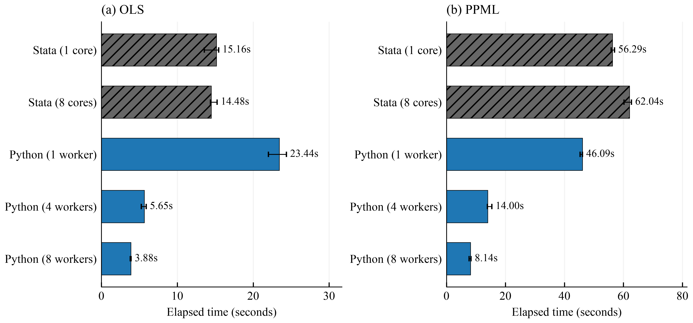

# Reproducible speed comparison



Bars show the median of three subsequent timed calls; whiskers show their
minimum and maximum. A separate first call is retained in the tables. Stata
labels count MP cores; Python labels count worker processes. These measurements
were executed on an AMD EPYC 7B13 host with 128 logical CPUs. The host was shared;
its finish-time load is recorded in [metadata.json](metadata.json).

## Data

All inputs are synthetic. One row represents one firm in one artificial period:
1,000 firms by 20 periods gives 20,000 observations. Periods are integers 0--19,
not calendar years. Firms 0--499 form group 0 and firms 500--999 form group 1;
each group has 10,000 rows. There are no missing input values or sampling weights.

The generator uses NumPy `default_rng(20261023)`. Regressors `x` and `z` are
independent standard normal draws. Each firm has a normal effect with standard
deviation 0.2. The linear predictor is:

```text
eta = 0.3 + firm_effect + 0.02 * year + (0.15 + 0.12 * group) * x + 0.2 * z
y ~ Poisson(exp(eta))
y_linear = eta + independent_standard_normal_noise
```

The Poisson outcome is drawn before the linear-outcome noise. OLS uses
`y_linear`; PPML uses `y`, including zeros. Within each model, Stata and Python
receive identical rows, regressors, groups, and outcomes. No external research
dataset is downloaded. The generated `.dta` is local and is not distributed.

## Models and timing

Both models include `x` and `z`, absorbing firm and period effects. Stata uses
`reghdfe` or `ppmlhdfe` with tolerance `1e-10`; Python uses PyFixest. Each command
executes 99 row-level permutations in `compatibility="stata"` mode. This uses
bdiff 1.04's regrouping principle. The sampling unit for this benchmark is a row;
the package also provides cluster sampling for applications that require it.

Python uses 1, 4, or 8 processes; each limits BLAS, Numba, and HiGHS threads to
one. Stata/MP uses 1 or 8 cores. Trial 0 is the first call; trials 1--3 follow in
the same parent process. Each trial uses `seed + trial`. No timing is discarded.
There are 2 models x 5 configurations x 4 trials = 40 timing observations.

The timer covers the complete difference-test command after input loading,
including initial subgroup fits and repeated fits. Python includes creation of
new workers where needed; subsequent calls may reuse workers. Data generation,
imports, Stata process launch, and plotting are outside the command timer.
Stata's timer includes bdiff's internal temporary-file operations. The additional
`process_seconds` field is a whole-Stata-process receipt and is not plotted.

Engines use their own RNGs; equal seeds do not equate their individual draws.
Exact draw-by-draw agreement is tested separately with exported Stata plans.
Baseline coefficient differences were checked across every timed call; maximum
errors were below `1e-15`. Software versions and exact errors are in metadata.

## All configurations

Times are seconds. The speedup denominator is Stata/MP with 8 cores. Full ranges,
first-call values, and speedups over serial Python are in [summary.csv](summary.csv).
[raw_timings.csv](raw_timings.csv) retains every measured call.

| Engine | Cores/workers | OLS median | OLS first | PPML median | PPML first |
|---|---:|---:|---:|---:|---:|
| Stata/MP | 1 | 15.165 | 14.123 | 56.290 | 57.676 |
| Stata/MP | 8 | 14.478 | 17.436 | 62.044 | 63.800 |
| Python | 1 | 23.439 | 22.275 | 46.092 | 45.943 |
| Python | 4 | 5.651 | 8.502 | 14.001 | 16.030 |
| Python | 8 | 3.878 | 4.960 | 8.137 | 8.104 |

The published run used StataNow 19.5, bdiff 1.04, reghdfe 6.12.3,
ppmlhdfe 2.3.3, PyFixest 0.60.0, NumPy 2.5.4, and pandas 2.3.3.
After BLAS and Numba limits were checked, HiGHS was also explicitly limited to
one thread per Python worker and Python PPML was remeasured. The Stata baselines
and OLS measurements were retained. The table and raw timings are that final run.

## Reproduce

From the repository root, follow [the development setup](../development.md):

```sh
uv sync --frozen --group dev --group benchmark
uv run python benchmarks/generate_data.py
uv run python benchmarks/benchmark.py --firms 1000 --years 20 --reps 99 --trials 3
uv run python benchmarks/plot_benchmark.py --input .local/benchmarks
```

The full timing run requires licensed Stata/MP, bdiff, reghdfe, and ppmlhdfe.
Set `STATA_BIN` if Stata is not on the executable search path. Generating the
synthetic data and replotting existing timings require only Python.

To redraw the published chart without rerunning estimations:

```sh
uv run python benchmarks/plot_benchmark.py --input docs/benchmarks
```

The plotter saves PNG and PDF under `.local/figures/`. It uses an installed
Times New Roman font when available and a portable serif fallback otherwise;
`--font /path/to/times.ttf` selects a local font explicitly. No font is bundled.
All generated data, local logs, PDFs, and rerun outputs remain untracked.

`--reuse-stata --cases PPML` repeats Python PPML while retaining prior Stata
measurements after checking data-size, seed, repetitions, and trial settings.
To regenerate the publication, copy reviewed CSV/metadata and PNG outputs into
this documentation directory. The source generator is
[examples/quickstart.py](../../examples/quickstart.py), exposed by
[benchmarks/generate_data.py](../../benchmarks/generate_data.py).
